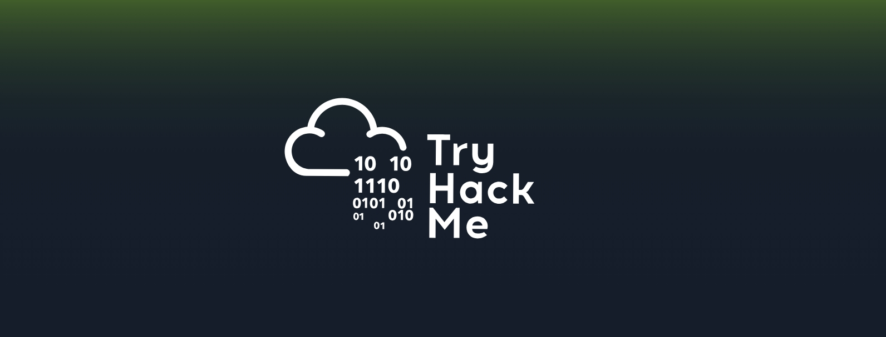

<link rel="stylesheet" href="/assets/main.css">

# TryHackMe Writeups

<nav style="background-color:#101827; padding:15px; border:1px solid #00e5ff; border-radius:6px;">
  <a href="/" style="color:#00e5ff; background:transparent; text-decoration:none;">Home</a>
  &nbsp; | &nbsp;
  <a href="/projects/" style="color:#00e5ff; background:transparent; text-decoration:none;">Projects</a>
  &nbsp; | &nbsp;
  <a href="/thm-writeups/" style="color:#00e5ff; background:transparent; text-decoration:none;">TryHackMe Write-ups</a>
</nav>

---

  

<h2>Welcome to My Try Hack Me Write-ups</h2>

This is where I document my hands-on cybersecurity journey through TryHackMe.
Each write-up covers the tools I used, techniques I practiced,
challenges I encountered, and lessons I learned.

My goal is to build real-world penetration testing skills
and document my progress along the way.

<h2>Completed Labs</h2>

  <a href="/thm-writeups/pre-security/"
     style="display:block; width:240px; max-width:100%; padding:20px;
     background:#101827; border:1px solid #00e5ff;
     border-radius:10px; text-decoration:none;">

    <h3 style="color:#00e5ff; margin-top:0;">Pre-Security</h3>

    

      Completed seven-module learning path covering computer fundamentals,
      operating systems, networking, web technologies, and security.
      Includes a comprehensive 21-page study guide.
    

    
View Write-up →

  </a>

  <a href="/thm-writeups/bricks-heist/"
     style="display:block; width:240px; max-width:100%; padding:20px;
     background:#101827; border:1px solid #00e5ff;
     border-radius:10px; text-decoration:none;">

    <h3 style="color:#00e5ff; margin-top:0;">Bricks Heist</h3>

    

      WordPress vulnerability exploitation,
      post-exploitation investigation,
      and cryptocurrency mining analysis.
    

    
View Write-up →

  </a>

